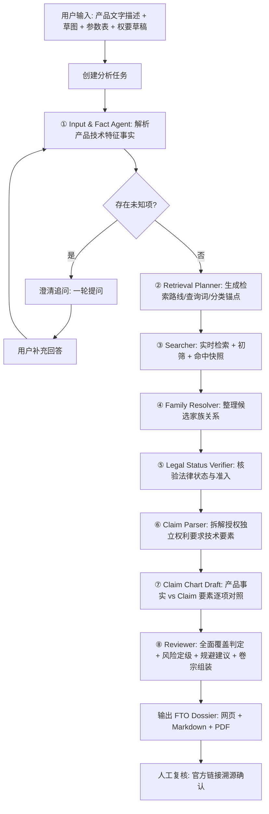
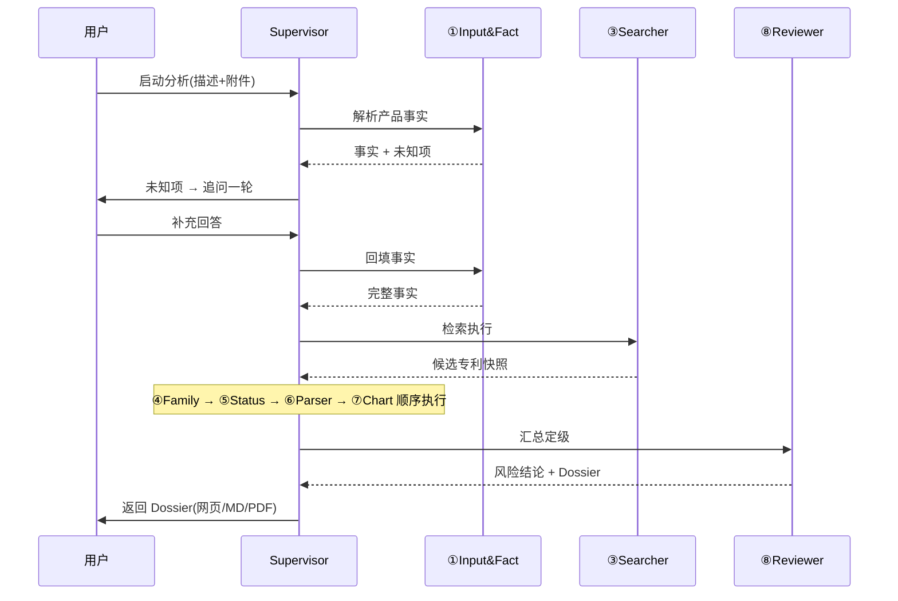
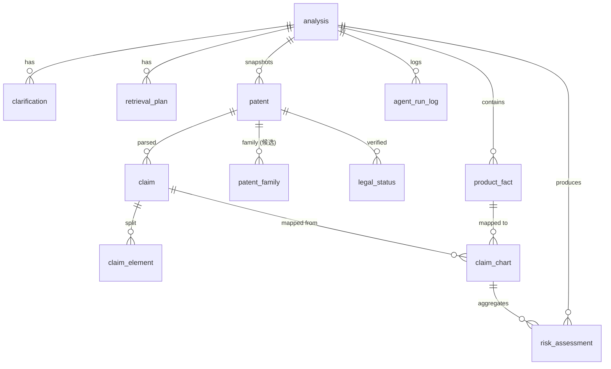
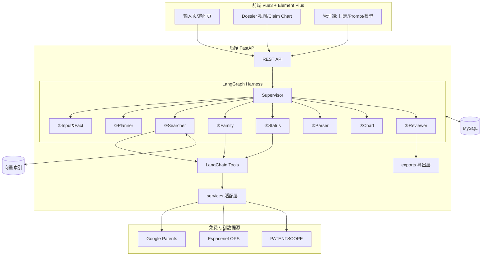

# FTO 多 Agent 专利自由实施分析系统
## 产品需求与架构设计文档（PRD + Architecture）

| 项目 | 内容 |
|---|---|
| 文档版本 | v1.0 |
| 状态 | 已评审定版（存档） |
| 日期 | 2026-10-16 |
| 关联参考 | 桔桔波编程学习网 · 多模态 Agent 图书推荐系统（技术栈基线） |

---

## 目录

1. [项目概述](#1-项目概述)
2. [目标与范围](#2-目标与范围)
3. [用户与核心场景](#3-用户与核心场景)
4. [核心业务流程](#4-核心业务流程)
5. [多 Agent 编排设计](#5-多-agent-编排设计)
6. [功能需求](#6-功能需求)
7. [数据模型](#7-数据模型)
8. [检索策略](#8-检索策略)
9. [降级策略](#9-降级策略)
10. [技术架构](#10-技术架构)
11. [API 设计](#11-api-设计)
12. [非功能需求](#12-非功能需求)
13. [风险与注意事项](#13-风险与注意事项)
14. [里程碑规划](#14-里程碑规划)

---

## 1. 项目概述

### 1.1 背景
在医疗器械研发中，一个产品创意在立项/申请专利前，必须回答一个关键问题：**这个产品会不会落入他人有效专利的权利要求保护范围（侵权风险）**。该分析称为 **FTO（Freedom to Operate，自由实施分析）**。目前此工作高度依赖专利律师人工检索与逐条比对，成本高、周期长。本项目用多 Agent 系统把 FTO 分析**自动化 + 可追溯化**，让研发人员在早期就能获得一份可复核的风险卷宗。

### 1.2 产品定位（一句话）
> 面向**中国法域**、聚焦**控弯导管（steerable/deflectable catheter）**细分领域的 FTO 分析系统：用户输入一段产品描述（可附结构草图、参数表、权利要求草稿），系统编排 8 个子 Agent 完成检索与权利要求比对，最终输出一份**证据可追溯的 FTO Dossier**。

### 1.3 核心价值
1. **降本**：把"律师人工检索+比对"压缩为"AI 初筛 + 人工最终复核"。
2. **可追溯**：每个结论都锚定到"哪件专利、哪条权利要求、哪个技术特征、哪段原文"。
3. **可离线降级**：无大模型 Key 时仍能走通全流程（规则引擎），保证可演示、可交付。
4. **权威边界清晰**：系统只做初筛与证据定位，**最终法律结论由人工/律师确认**。

### 1.4 术语表

| 术语 | 释义 |
|---|---|
| FTO | Freedom to Operate，自由实施分析：产品是否会侵犯他人有效专利权利要求 |
| Dossier | 卷宗/案卷：把检索、证据、比对、结论打包成的完整档案，非一页结论 |
| Claim Chart | 权利要求对照表：产品技术特征 vs 专利权利要求技术要素的逐项比对表 |
| 全面覆盖原则 | all-elements rule：产品覆盖独立权利要求的**全部**技术要素才构成字面侵权 |
| 独立权利要求 | 不引用其他权要、保护范围最宽的权利要求（FTO 比对的主对象） |
| 同族专利 | 同一优先权在不同法域/不同阶段产生的一组专利（分案、继续申请等） |
| 法律状态 | 专利在目标法域的有效性（有效/失效/审中/届满/视为放弃/撤回等） |
| IPC / CPC | 国际/合作专利分类号，用于检索锚定技术领域 |

---

## 2. 目标与范围

### 2.1 目标
- 端到端完成一次中国法域 FTO 分析：输入 → 澄清 → 检索 → 法律状态核验 → 权要解析 → 特征比对 → 风险定级 → Dossier 导出。

### 2.2 法域
- **仅中国（CN）**。检索与法律状态过滤均以中国有效专利为准。

### 2.3 技术领域
- 控弯导管（含导引导管、消融导管等导管类，IPC 锚点 A61M 25 系列）。

### 2.4 In Scope / Out of Scope

| In Scope | Out of Scope |
|---|---|
| 中国法域 FTO 分析 | 全球/多法域 FTO |
| 字面侵权（全面覆盖）级别比对 | 等同侵权（doctrine of equivalents）的权威判定 |
| 控弯导管领域（可扩展分类锚点） | 全技术领域通用检索 |
| AI 初筛 + 证据定位 + 人工复核 | 出具具有法律效力的正式意见 |
| 免费公开数据源 | 商业专利库（智慧芽/incoPat 等） |
| 专利性分析（新颖性/创造性） | ——（明确只做 FTO，不做能否授权） |

---

## 3. 用户与核心场景

### 3.1 用户画像
- **研发工程师 / 产品经理**：有产品想法，想快速了解侵权风险。
- **IP 专员 / 专利代理人**：用系统做初筛，再人工复核关键专利。

### 3.2 核心用例

```
用例 1：产品早期 FTO 摸底
  工程师输入控弯导管结构描述 + 上传草图 → 系统追问补充 → 输出 Dossier → 查看高风险专利 Claim Chart → 导出 PDF 给法务。

用例 2：权利要求草稿比对
  用户上传权利要求草稿 → 系统将草稿拆成产品特征 → 与现有专利权要比对。

用例 3：管理端运维
  管理员查看 Agent 运行日志、Prompt 在线编辑、模型配置热切换、检索快照列表。
```

---

## 4. 核心业务流程

### 4.1 端到端流程



### 4.2 澄清追问闭环
- 规则：`Input & Fact Agent` 提取产品事实时，将无法从资料确认的项标记为**未知项**，并生成追问问题。
- 交互：**限一轮追问**，用户补充回答后回填 `product_fact` 再继续分析；未回答的未知项在后续比对中标注"存疑"。

---

## 5. 多 Agent 编排设计

### 5.1 编排模式
采用参考项目的 **Supervisor + Workers** 模式，共 **1 Supervisor + 8 子 Agent**。

```
[Supervisor] 总调度 · 轮次控制(MAX_LOOPS=6) · 防死循环(recursion_limit=30) · 记录 trace
   ├─ ① Input & Fact Agent
   ├─ ② Retrieval Planner
   ├─ ③ Searcher
   ├─ ④ Family Resolver
   ├─ ⑤ Legal Status Verifier
   ├─ ⑥ Claim Parser
   ├─ ⑦ Claim Chart Draft
   └─ ⑧ Reviewer / Dossier Builder
```

### 5.2 各 Agent 职责与输入输出

| # | Agent | 职责 | 输入 | 输出 |
|---|---|---|---|---|
| ① | Input & Fact Agent | 多模态解析产品资料，提取结构事实、未知项、证据定位；发起追问 | 文字描述、草图(图)、参数表(表)、权要草稿(文本) | product_fact 清单 + clarification 问题 |
| ② | Retrieval Planner | 由已确认事实生成检索路线、查询词、IPC/CPC 分类锚点 | product_fact | retrieval_plan |
| ③ | Searcher | 执行实时检索、去重、相关性初筛、落命中快照 | retrieval_plan | patent 候选清单(含纳入/排除理由) |
| ④ | Family Resolver | 整理候选同族关系与待核验证据，**不自行确认同族** | patent 清单 | patent_family(待核验) |
| ⑤ | Legal Status Verifier | 检查官方状态证据、法域、日期是否满足准入 | patent 清单 | legal_status(准入/排除) |
| ⑥ | Claim Parser | 拆解授权独立权利要求的技术要素与原文定位 | 准入专利 | claim + claim_element |
| ⑦ | Claim Chart Draft | 产品事实 vs Claim 要素逐项对照，形成审核草稿 | product_fact + claim_element | claim_chart |
| ⑧ | Reviewer | 全面覆盖判定 → 风险定级 → 规避建议 → Dossier 组装导出 | claim_chart + legal_status | risk_assessment + dossier |

### 5.3 Agent 协作时序



### 5.4 工具清单（LangChain Tools）

| Agent | 挂载工具 |
|---|---|
| ① Input & Fact | 视觉识图、文档解析(PDF/Excel)、追问用户 |
| ② Retrieval Planner | IPC/CPC 分类查询、术语/同义词扩展 |
| ③ Searcher | search_patents、get_patent_detail、get_legal_status(初查) |
| ④ Family Resolver | get_family_members |
| ⑤ Legal Status Verifier | get_legal_status(OPS 官方)、verify_jurisdiction |
| ⑥ Claim Parser | get_claims、split_claims |
| ⑦ Claim Chart Draft | compare_features |
| ⑧ Reviewer | export_markdown、export_pdf |

---

## 6. 功能需求

### 6.1 输入
- 支持：产品**文字描述**、**结构草图（图片）**、**参数表（Excel/PDF 表格）**、**权利要求草稿（文本/PDF）**。
- 多模态解析统一产出"产品技术特征事实 + 证据定位"。

### 6.2 澄清追问
- 一轮追问；未回答项标注"存疑"进入后续流程。

### 6.3 分析执行
- 按第 5 节编排顺序自动执行，全程写 `agent_run_log`（node/intent/输入输出/tool_calls/耗时）。

### 6.4 Dossier 输出（8 板块）

| # | 板块 | 内容 |
|---|---|---|
| 1 | 执行摘要 | 命中 N 件高风险 / M 件中风险；建议"可推进 / 需规避 / 需律师复核" |
| 2 | 检索策略 | 关键词、同义词、IPC/CPC、检索式、数据库、时间/地域范围 |
| 3 | 专利清单 | 专利号、标题、申请人、申请日、法律状态、相关性 |
| 4 | Claim Chart | 产品特征 vs 独立权要逐项对照：命中/缺失/部分/存疑 |
| 5 | 风险分级 | 高/中/低 + 全面覆盖判定理由 |
| 6 | 规避设计建议 | 对高风险专利的可操作规避方向 |
| 7 | 证据与溯源 | 每结论附权要原文、官方链接、命中快照 |
| 8 | 免责声明 | 非法律意见，最终需专利律师签字 |

### 6.5 导出
- **网页端**：Dossier 交互视图（Markdown 渲染 + 可交互 Claim Chart 表格 + 风险色块）。
- **Markdown**：完整卷宗模板生成。
- **PDF**：reportlab + Noto Sans CJK 中文字体。

### 6.6 管理端
- Agent 运行日志 / 节点统计、检索快照列表、Prompt 在线编辑（热生效）、模型配置 + 连接测试、运营大屏。

### 6.7 用户账户
- 注册 / 登录（pbkdf2 + HMAC Token）、我的分析列表、分析历史。

---

## 7. 数据模型

共 **5 组 19 张表**（Tortoise ORM + MySQL 8.0，可切 SQLite）。

### 7.1 表清单

| 分组 | 表 |
|---|---|
| 基础(沿用) | user, admin, agent_run_log, prompt_template, llm_config |
| FTO 核心 | analysis, product_fact, clarification, retrieval_plan, patent, patent_family, legal_status, claim, claim_element, claim_chart, risk_assessment |
| 支撑 | ipc_code, file_asset, search_cache, vector_index |

### 7.2 核心表字段（节选，字段级）

**analysis** — 分析主卷宗
`id, user_id, title, status(1草稿/2进行中/3待人工复核/4完成/5失败), product_description, input_files(json), jurisdiction(CN), risk_summary(json), executive_summary(md), dossier_markdown(md), dossier_pdf_path, disclaimer, create_time, update_time`

**product_fact** — 产品技术特征事实
`id, analysis_id, feature, feature_type(结构/材料/连接/运动/参数/功能), value, evidence, confidence, is_unknown, status(1已确认/2存疑/3待追问/4已追问)`

**clarification** — 追问记录
`id, analysis_id, round, question, answer, fact_ids(json), create_time`

**retrieval_plan** — 检索计划
`id, analysis_id, query_terms(json), ipc_anchors(json), search_expressions(json), data_sources(json), date_range(json), status, create_time`

**patent** — 专利命中快照（按分析隔离）
`id, analysis_id, patent_no(唯一索引), title, abstract, applicant, inventor, application_date, publication_date, grant_date, ipc_codes(json), cpc_codes(json), source, source_url, raw_snapshot, relevance_score, screen_status(1候选/2排除/3待定), screen_reason, create_time`

**patent_family** — 家族关系（不自行确认）
`id, analysis_id, patent_id, family_id, related_patent_no, relation_type, evidence, status(1待核验/2已核验/3存疑), note`

**legal_status** — 法律状态快照
`id, analysis_id, patent_id, jurisdiction, status(有效/失效/审中/届满/视为放弃/撤回), status_date, status_source, source_url, fee_status, admissibility(1准入/2排除), admissibility_reason, verify_time`

**claim** — 权利要求
`id, analysis_id, patent_id, claim_no, claim_type(1独立/2从属), claim_text, text_location, status(1已解析/2需人工)`

**claim_element** — 技术要素
`id, analysis_id, patent_id, claim_id, element_no, element_text, element_category, text_location`

**claim_chart** — 特征对照（核心表）
`id, analysis_id, patent_id, claim_id, product_fact_id, match_status(命中/缺失/部分/存疑), rationale, evidence_product, evidence_claim, confidence, is_full_coverage, create_time`

**risk_assessment** — 风险定级
`id, analysis_id, patent_id, risk_level(高/中/低/排除), basis, design_around, conclusion, create_time`

**agent_run_log** — 可观测日志
`id, analysis_id, node, intent, input(json), output(json), tool_calls(json), duration_ms, status(1成功/2降级/3失败), create_time`

### 7.3 支撑表（简要）

| 表 | 关键字段 | 作用 |
|---|---|---|
| ipc_code | code, level, title_zh, title_en, parent_code, keywords | IPC/CPC 分类锚点种子数据 |
| file_asset | file_type, file_path, parsed_content, status | 上传附件 + 解析结果 |
| search_cache | cache_key, query, result_json, ttl, expire_at | 检索缓存(TTL 24h) |
| vector_index | patent_id, doc_text, vector, dim, model_used | 自研向量库持久化 |
| prompt_template | scene, content, enabled, version | Prompt 中心(DB 优先) |
| llm_config | provider, base_url, chat_model, vision_model, embed_model, enabled | 模型配置热加载 |

### 7.4 ER 关系



---

## 8. 检索策略

### 8.1 术语扩展（控弯导管）

| 中文 | 英文 | 同义词/变体 |
|---|---|---|
| 控弯导管 | steerable catheter | 可调弯、可控弯曲、可偏转、可转向 |
| 导引导管 | guiding catheter | 指引导管、输送导管 |
| 消融导管 | ablation catheter | 射频消融、冷冻消融 |
| 弯曲段 | deflectable section | 可弯段、偏转段、柔性段 |
| 拉线机构 | pull wire | 牵引丝、控制线、张力线 |

### 8.2 IPC/CPC 分类锚点

| 分类号 | 含义 |
|---|---|
| **A61M 25/092** | 导管远端操控/弯曲控制装置（核心锚点） |
| A61M 25/01 | 导管；空心探针 |
| A61M 25/10 | 球囊导管 |
| A61M 25/09 | 导丝 |
| A61B 18/14 | 消融导管（射频） |
| A61B 17/00 | 外科器械 |

### 8.3 检索式示例（Google Patents 语法）

```
(控弯 OR 可调弯 OR 可控弯曲 OR 可偏转 OR 可转向) AND 导管 country:CN status:GRANT
(steerable OR deflectable OR bendable) AND catheter country:CN status:GRANT
A61M25/092 country:CN status:GRANT
(拉线 OR 牵引丝 OR pull wire) AND A61M25/092 country:CN
(steerable AND catheter) country:CN status:GRANT after:priority:20000101
```

> 原则：检索阶段**宁松勿紧**（审中也纳入），最终法律状态由 Verifier 现查裁决。

---

## 9. 降级策略

### 9.1 Agent 层降级（无 LLM Key）

| Agent | 有 LLM | 无 LLM（规则引擎） |
|---|---|---|
| Input & Fact | 结构化抽取 | 正则 + 词典抽特征 |
| Retrieval Planner | 生成检索式 | 关键词 + 固定 IPC 锚点拼布尔式 |
| Searcher | 动态换检索式、判相关 | 固定检索式打库，关键词命中数判相关 |
| Family Resolver | 归纳关系 | 按公开号/优先权号规则分组 |
| Legal Status Verifier | 判准入 | 规则匹配状态词 |
| Claim Parser | 语义切要素 | 正则按"；、包括、其特征在于"切分 |
| Claim Chart Draft | 语义比对 | 关键词重合度 + 要素级包含判断 |
| Reviewer | 归纳定级写摘要 | 模板拼装 |

### 9.2 数据源降级链

```
Google Patents ──失败──▶ Espacenet OPS ──失败──▶ PATENTSCOPE ──失败──▶ 明确报错 + 返回已获证据
```
每个源独立：并发 ≤3、间隔 0.2s、失败重试 1 次、结果缓存 TTL 24h、**绝不静默编造**。

### 9.3 视觉 / Embedding 降级

| 能力 | 有 Key | 无 Key |
|---|---|---|
| 结构草图识别 | 视觉大模型 | PIL 弱标签 + 强制"需人工看图" |
| Embedding | OpenAI text-embedding | 字符 n-gram 哈希向量(1024 维) |
| 向量检索 | 语义召回 | 关键词精确/包含匹配 |

---

## 10. 技术架构

### 10.1 技术栈

| 层 | 选型 | 相对参考项目 |
|---|---|---|
| 后端 | FastAPI 0.124 + Uvicorn | 沿用 |
| ORM/DB | Tortoise ORM + MySQL 8.0（可切 SQLite） | 沿用 |
| 校验 | Pydantic v2 | 沿用 |
| Harness | LangGraph(StateGraph+InMemorySaver) + LangChain | 沿用 |
| LLM | langchain-openai 协议（DeepSeek/OpenAI/Qwen/智谱/Moonshot/Ollama） | 沿用 |
| 视觉 | qwen-vl-max / GPT-4o / GLM-4V | 沿用参考项目 multimodal |
| 向量库 | 自研 numpy 余弦 + JSON（可选 pgvector） | 沿用 |
| 前端 | Vue3 + Vite + Vue Router 4 + Pinia + axios | 沿用 |
| UI | Element Plus + ECharts | 沿用 |
| Markdown | markdown-it + highlight.js | 沿用 |
| 认证 | pbkdf2 + HMAC Token | 沿用 |
| 可观测 | agent_run_log + trace + Prompt 中心 + 模型热加载 | 沿用 |
| 专利源适配 | httpx + service 封装（Google Patents/Espacenet/PATENTSCOPE） | 新增 |
| 文档解析 | pdfplumber/pypdf/openpyxl/camelot | 新增 |
| 导出 | reportlab + Noto Sans CJK | 新增 |

### 10.2 系统架构图



### 10.3 目录结构（镜像参考项目）

```
fto_agent_system/
├─ fastapi-app/
│  ├─ main.py / settings.py / models.py
│  ├─ api/                    # 路由（自动扫描注册）
│  ├─ agent/                  # LangGraph 编排层
│  │  ├─ graph.py             # Supervisor + 8 Worker + 防死循环
│  │  ├─ nodes/               # 8 个子 Agent 节点
│  │  ├─ tools.py / llm.py / vectorstore.py / memory.py / multimodal.py / prompts.py
│  ├─ services/               # 专利数据源适配层
│  ├─ exports/                # Markdown/PDF 导出
│  ├─ common/                 # 统一响应/异常/鉴权/安全
│  ├─ sql/fto_system.sql      # 建表 + 种子数据
│  ├─ files/                  # 上传图/草图/参数表
│  └─ data/                   # 向量库/检索缓存/分类表
├─ vue/
│  ├─ src/views/manager/      # 管理端
│  ├─ src/views/front/        # 门户端
│  ├─ src/router/index.js
│  └─ src/utils/request.js
└─ fto_system.sql             # 管理员表
```

---

## 11. API 设计

统一响应体：`{ code, msg, data }`；鉴权 token 放 Header `token`。

| 模块 | 接口 |
|---|---|
| 认证 | POST /api/auth/login, POST /api/auth/register, GET /api/user/info |
| 分析 | POST /api/fto/analysis（创建）, POST /api/fto/analysis/{id}/upload, POST /api/fto/analysis/{id}/clarify, POST /api/fto/analysis/{id}/run, GET /api/fto/analysis/{id}/status, GET /api/fto/analysis/{id}/dossier, GET /api/fto/analysis/list |
| 导出 | GET /api/fto/analysis/{id}/export/markdown, GET /api/fto/analysis/{id}/export/pdf |
| 检索快照 | GET /api/fto/analysis/{id}/patents, GET /api/fto/analysis/{id}/claims/{patentId} |
| 运维 | GET /api/fto/agent/logs, GET /api/fto/agent/stats, GET/PUT /api/fto/prompt, GET/PUT /api/fto/llm/config, POST /api/fto/llm/test |
| 大屏 | GET /api/fto/dashboard/overview |
| 文件 | POST /api/files/upload, GET /api/files/download/{filename} |

---

## 12. 非功能需求

| 维度 | 要求 |
|---|---|
| 性能 | 单次分析检索阶段目标 ≤ 3 分钟（受免费源限流影响，可配置超时） |
| 可观测 | 每个 Agent 节点写 agent_run_log；一次分析返回完整 trace |
| 安全 | 文件上传类型/大小校验、防路径穿越、pbkdf2 密码摘要、生产改密钥 |
| 合规 | 所有结论附免责声明；法律状态以官方登记簿为准、人工最终确认 |
| 降级 | 无 LLM Key 全流程规则引擎可跑通；数据源三级降级 |
| 可追溯 | 每个风险结论可追溯到专利号 + 权要序号 + 技术要素 + 原文定位 |

---

## 13. 风险与注意事项

1. **免费数据源脆弱**：Google Patents 接口非官方、可能变更/反爬；需三级降级 + 缓存 + 官方链接溯源。
2. **法律状态时效**：INPADOC 对 CN 有延迟，检索快照必须带时间戳，最终以 CNIPA 官方为准。
3. **等同侵权**：系统只做到"字面侵权（全面覆盖）"级提示，等同侵权必须人工/律师。
4. **免责边界**：输出必须显著标注"非法律意见"，不作为商业决策唯一依据。
5. **领域适配**：控弯导管的术语/分类锚点需持续迭代，种子数据要可在线维护。

---

## 14. 里程碑规划

| 阶段 | 交付物 | 说明 |
|---|---|---|
| M1 骨架 | main.py + models.py(19 表) + 路由 + 鉴权 | 后端可启动、可建表 |
| M2 Harness | graph.py + 8 node 空实现 + trace + 降级框架 | 编排跑通、日志可查 |
| M3 数据源 | services 适配层 + 检索缓存 + 检索式 | 实时检索可用 |
| M4 分析链 | 事实解析 → 追问 → 权要解析 → Claim Chart | 核心比对链路 |
| M5 输出 | Reviewer + Dossier + 三端导出 | 端到端闭环 |
| M6 前端 | 门户端(输入/追问/Dossier) + 管理端 | 可视化闭环 |
| M7 打磨 | 降级完善、Prompt 调优、种子数据、文档 | 交付评审 |

---

*本文档为项目存档基线，后续变更需更新版本号与变更记录。*
